<p align="center">
  
</p>

<p align="center">
  <a href="https://www.linkedin.com/in/akhandchauhan47/"></a>
  <a href="https://leetcode.com/u/Panda_Singh/"></a>
  <a href="https://github.com/akhandchauhan/daily-data-engineering-practice"></a>
</p>


## `01` ▸ WHOAMI

```yaml
role:     Data Engineer
builds:   data pipelines & analytics platforms
range:    local PySpark/Airflow  →  cloud-native ETL on GCP
learning: dbt (warehouse transformation + testing)
```

## `02` ▸ ACTIVE MISSIONS

| Mission | Stack | What it does |
|---|---|---|
| 🚕 [**NYC-Uber-Analytics-Using-GCP-MAGE**](https://github.com/akhandchauhan/NYC-Uber-Analytics-Using-GCP-MAGE) | GCP · Mage · BigQuery | End-to-end pipeline: ingestion → transformation → warehouse → BI |
| 🌋 [**EarthquakeMonitor_MSFabric**](https://github.com/akhandchauhan/EarthquakeMonitor_MSFabric) | Microsoft Fabric | Medallion lakehouse: bronze → silver → gold |
| 🌀 [**Airflow_practice**](https://github.com/akhandchauhan/Airflow_practice) | Apache Airflow | Branching, trigger rules, TaskFlow API |
| ⚡ [**daily-data-engineering-practice**](https://github.com/akhandchauhan/daily-data-engineering-practice) | SQL · Pandas | 226 SQL solutions + 176 pandas notebooks, solved daily |


## `03` ▸ TECH STACK

<p align="center">
  
</p>

<p align="center">
  
  
  
  
</p>

## `04` ▸ TELEMETRY

<p align="center">
  
  
</p>

<p align="center">
  
</p>
