<picture>
  <source media="(prefers-color-scheme: dark)" srcset="assets/banner-dark.svg" />
  <source media="(prefers-color-scheme: light)" srcset="assets/banner-light.svg" />
  
</picture>

<p align="center">
  <a href="https://www.linkedin.com/in/akhandchauhan47/"></a>
  <a href="https://leetcode.com/u/Panda_Singh/"></a>
  <a href="https://github.com/akhandchauhan/daily-data-engineering-practice"></a>
</p>

<br/>

### `>` whoami

```yaml
role:     data engineer
builds:   pipelines & analytics platforms
range:    local pyspark/airflow → cloud-native etl on gcp
learning: dbt
```

### `>` projects

- [**NYC-Uber-Analytics-Using-GCP-MAGE**](https://github.com/akhandchauhan/NYC-Uber-Analytics-Using-GCP-MAGE) — ingestion → transformation → warehouse → BI on GCP + Mage
- [**EarthquakeMonitor_MSFabric**](https://github.com/akhandchauhan/EarthquakeMonitor_MSFabric) — medallion lakehouse, bronze → silver → gold
- [**Airflow_practice**](https://github.com/akhandchauhan/Airflow_practice) — branching, trigger rules, TaskFlow API
- [**daily-data-engineering-practice**](https://github.com/akhandchauhan/daily-data-engineering-practice) — 226 SQL solutions + 176 pandas notebooks

### `>` stack

<picture>
  <source media="(prefers-color-scheme: dark)" srcset="https://skillicons.dev/icons?i=python,mysql,docker,gcp,fastapi,git,github,vscode&theme=dark" />
  <source media="(prefers-color-scheme: light)" srcset="https://skillicons.dev/icons?i=python,mysql,docker,gcp,fastapi,git,github,vscode&theme=light" />
  
</picture>

`pyspark` · `airflow` · `dbt` · `mage`

### `>` stats

<picture>
  <source media="(prefers-color-scheme: dark)" srcset="https://raw.githubusercontent.com/akhandchauhan/akhandchauhan/stats/stats-dark.svg" />
  <source media="(prefers-color-scheme: light)" srcset="https://raw.githubusercontent.com/akhandchauhan/akhandchauhan/stats/stats-light.svg" />
  
</picture>

<br/>
<br/>

<sub>fail gracefully · scale predictably · stay observable</sub>
